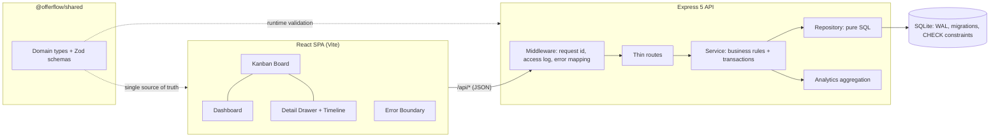

# OfferFlow

**A full-stack job application tracker** — kanban pipeline, activity timeline, and analytics dashboard. Built to turn a chaotic job search into a measurable process.


## Why

Job hunting produces dozens of applications across different stages, sources, and deadlines. Spreadsheets don't show you _where the process leaks_. OfferFlow does: drag cards through the pipeline, log every interaction, and watch response/offer rates update in real time.

## Features

- **Kanban board** — six-stage pipeline (Wishlist → Applied → Screening → Interview → Offer / Rejected) with native drag-and-drop and optimistic UI updates
- **Analytics dashboard** — response rate, offer rate, median salary, weekly activity chart, pipeline funnel, and source effectiveness (which channel actually produces offers)
- **Activity timeline** — every status change is recorded automatically; log calls, emails, notes, and tasks per application
- **Touch & keyboard friendly** — change status right in the detail drawer (HTML5 drag-and-drop doesn't exist on touch screens)
- **Full CRUD** — create/edit forms with client- and server-side validation, search by company/role/location
- **Demo mode** — one-click reset to a realistic seeded dataset (16 applications across European tech companies)
- **Zero-dependency charts** — SVG charts hand-built without chart libraries
- **Production-ready** — Docker multi-stage build, GitHub Actions CI, health checks, strict TypeScript everywhere

## Tech stack

| Layer    | Technology                                                    |
| -------- | ------------------------------------------------------------- |
| Frontend | React 18, TypeScript (strict), Vite, hand-rolled SVG charts   |
| Backend  | Node.js 22.13+, Express 5, Zod validation                     |
| Database | SQLite via built-in `node:sqlite` (no native deps, WAL mode)  |
| Testing  | Vitest, Supertest, Testing Library — 110 tests                |
| Tooling  | ESLint 9 (flat config), Prettier, npm workspaces              |
| DevOps   | GitHub Actions CI, multi-stage Dockerfile, non-root container |

## Architecture



- **Monorepo** with npm workspaces: `shared/`, `client/`, `server/`
- **Shared contract**: domain types and Zod schemas live in `@offerflow/shared` — contract drift becomes a compile error, not a runtime bug
- **Layered server**: routes → service → repository; business rules are testable without HTTP, SQL without rules
- **Atomic writes**: application + events commit in one transaction (re-entrant via SAVEPOINTs)
- **Forward-only migrations** with baselining for pre-existing databases
- **Observability**: structured JSON logs, per-request ids echoed to the client, coded error bodies
- **Graceful shutdown**: SIGTERM drains in-flight requests before closing the DB
- In production the Express server serves the built SPA — **one container, one port**

Design rationale is documented as ADRs in [`docs/adr/`](docs/adr/).

## Quick start

```bash
# requires Node.js >= 22.13 (first release with unflagged node:sqlite;
# enforced via engines + engine-strict, and CI tests the exact floor)
npm install
npm run dev        # API on :3000, Vite dev server on :5173 (proxies /api)
```

Open http://localhost:5173 — the database is created and seeded with demo data automatically.

### Production build

```bash
npm run build      # builds client, then server
npm start          # serves API + built SPA on :3000
```

### Docker

```bash
docker build -t offerflow .
docker run -p 3000:3000 -v offerflow-data:/data offerflow
```

## Scripts

| Command             | Description                           |
| ------------------- | ------------------------------------- |
| `npm run dev`       | Run API + client in watch mode        |
| `npm test`          | Run all test suites (server + client) |
| `npm run lint`      | ESLint across the monorepo            |
| `npm run typecheck` | Strict TypeScript checks              |
| `npm run build`     | Production build (client + server)    |
| `npm start`         | Serve production build                |
| `npm run format`    | Prettier                              |

## API reference

| Method   | Endpoint                       | Description                                                            |
| -------- | ------------------------------ | ---------------------------------------------------------------------- |
| `GET`    | `/api/health`                  | Health check + application count                                       |
| `GET`    | `/api/applications`            | List; `?status=`, `?q=`, `?limit=`, `?offset=`; `X-Total-Count` header |
| `POST`   | `/api/applications`            | Create (Zod-validated)                                                 |
| `GET`    | `/api/applications/:id`        | Details with full event timeline                                       |
| `PATCH`  | `/api/applications/:id`        | Partial update; auto-logs status changes                               |
| `DELETE` | `/api/applications/:id`        | Delete (cascades events)                                               |
| `POST`   | `/api/applications/:id/events` | Log a note / call / email / task                                       |
| `GET`    | `/api/analytics/overview`      | Aggregated metrics for the dashboard                                   |
| `POST`   | `/api/demo/reset`              | Restore the demo dataset                                               |

Validation errors return `400` with a structured `details` array (`{ path, message }`) that the UI maps onto form fields.

## Security posture

Hardened against failure modes reported in comparable open-source projects (full source links in [ADR-0005](docs/adr/0005-hardening-from-field-reports.md)):

- **CSRF**: state-changing requests with a body must be `application/json` (`415` otherwise — defeats "simple request" form posts); browser mutations need a same-origin `Origin`, an origin in `TRUSTED_ORIGINS`, or a loopback origin in development. Header-less clients (curl) are unaffected.
- **DNS rebinding**: optional `TRUSTED_HOSTS` Host-header allowlist on the API; the Vite dev server uses an explicit `VITE_ALLOWED_HOSTS` list — never `allowedHosts: true`.
- **SQLite contention**: `busy_timeout=5000` set before WAL, `BEGIN IMMEDIATE` write transactions, `synchronous=NORMAL`.
- **Headers**: `X-Content-Type-Options: nosniff`, `Referrer-Policy: no-referrer`, `x-powered-by` disabled.
- Configuration knobs are documented in [`server/.env.example`](server/.env.example) and [`client/.env.example`](client/.env.example).

## Testing

```bash
npm test
```

- **API tests** (Supertest): CRUD, filtering, pagination (`X-Total-Count`, page tiling), literal `%`/`_`/`\` search, validation edge cases, coded errors (`VALIDATION_FAILED`, `NOT_FOUND`, `INVALID_JSON`), request-id propagation and sanitization, analytics correctness, empty-DB safety
- **Security tests**: cross-site CSRF rejected (including bodyless `demo/reset`), same-origin and trusted-origin flows, `415` for non-JSON mutations, Host allowlist vs DNS rebinding, SPA-fallback route-syntax regression
- **Service tests**: business rules with an injected clock — deterministic timestamps, `appliedAt` stamping rules, atomic rollback of a failing demo reset, SAVEPOINT semantics
- **Migration & contention tests**: idempotency, baselining a legacy database, persistence across reopen, CHECK constraints; `busy_timeout` actually waits under a held lock, `BEGIN IMMEDIATE` holds the write lock from the start, and the WAL deferred-upgrade hazard is reproduced as a documented anti-test
- **Config/logger tests**: fail-fast env validation, allowlist parsing, log levels, structured bindings
- **Client tests**: salary/date formatting, relative time, avatar colors; optimistic-overlay merge rules; hook-level race regressions (stale refetch discarded, superseded move failure doesn't roll back newer state, in-flight refetch doesn't clobber a pending move); API-client paging; drawer load-race and no-refetch-on-rerender guarantees — two overlapping calls resolved out of order, not happy-path-only
- CI runs lint → typecheck → tests → build on every push and PR, on **both** Node 22.13.0 (the declared floor) and the latest 22.x

## Project structure

```
├── shared/                 # @offerflow/shared — the contract
│   └── src/
│       ├── types.ts        # domain types + enums (browser-safe, zero deps)
│       └── schemas.ts      # Zod schemas (separate entry point)
├── client/                 # React SPA
│   └── src/
│       ├── components/     # Board, Card, Dashboard, Form, Drawer, charts/, ErrorBoundary
│       ├── hooks/          # useApplications — race-guarded list state (+ tests)
│       ├── lib/            # pure helpers (+ unit tests)
│       ├── api.ts          # typed fetch client (codes + request ids)
│       └── types.ts        # re-exports shared contract + UI metadata
├── server/                 # Express API
│   ├── src/
│   │   ├── app.ts          # composition root (dependency injection)
│   │   ├── http/           # thin routes + middleware (errors, logging, request id, security)
│   │   ├── service.ts      # business rules, transactions, injected clock
│   │   ├── repository.ts   # pure SQL data access
│   │   ├── db.ts           # migrations, baselining, transaction helper
│   │   ├── analytics.ts    # metric aggregation
│   │   ├── config.ts       # fail-fast env validation
│   │   ├── logger.ts       # structured JSON logger
│   │   ├── errors.ts       # typed domain errors
│   │   └── seed.ts         # demo dataset
│   └── tests/              # API, security, service, migration, contention, config suites
├── docs/adr/               # architecture decision records
├── .github/workflows/      # CI
└── Dockerfile              # multi-stage, non-root, healthcheck
```

## Design decisions

Full rationale lives in [`docs/adr/`](docs/adr/); the short version:

- **Shared contract package** ([ADR-0001](docs/adr/0001-shared-contract-package.md)) — types and Zod schemas in one workspace package; contract drift fails the build on both sides.
- **Layered server** ([ADR-0002](docs/adr/0002-layered-architecture.md)) — routes → service → repository, with an injected clock and a composition root for testability.
- **Migrations + transactions** ([ADR-0003](docs/adr/0003-migrations-and-transactions.md)) — forward-only schema history, baselining for legacy DBs, atomic multi-writes via re-entrant SAVEPOINTs, CHECK constraints as a safety net.
- **Observability + lifecycle** ([ADR-0004](docs/adr/0004-observability-and-lifecycle.md)) — structured logs, request ids end-to-end, fail-fast config, graceful shutdown.
- **Hardening from field reports** ([ADR-0005](docs/adr/0005-hardening-from-field-reports.md)) — every fix traced to a published issue in our exact stack: `busy_timeout` + `BEGIN IMMEDIATE` for SQLite lock errors, a real Node floor, Vite Host allowlist instead of `allowedHosts: true`, CSRF/Origin/Content-Type guards, and race-proof optimistic UI.
- **`node:sqlite` over an ORM** — the domain is small; plain SQL with a repository layer keeps the data flow explicit and the dependency tree tiny.
- **Native HTML5 drag-and-drop** — no dnd library needed for a single-board use case; the drawer's status select covers touch devices and keyboard users.
- **Hand-built SVG charts** — three focused visualizations don't justify a 300 KB charting dependency.
- **Optimistic updates** — moving a card updates the UI instantly; race guards (latest-only refetch, per-card mutation sequencing, pending-status overlay) keep out-of-order responses from clobbering newer state.
- **Events as a first-class table** — status history is never overwritten, which makes the timeline and analytics trustworthy.
- **Complete reads** — the list endpoint reports `X-Total-Count` and the client follows it page by page, so the board never silently truncates at the server's page default; search escapes LIKE metacharacters so `100%` finds `100%`, not everything.

## Roadmap

- [ ] Authentication & multi-user support
- [ ] CSV import/export
- [ ] Interview reminders
- [ ] Playwright end-to-end tests

## License

[MIT](LICENSE)
