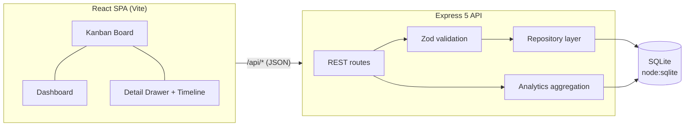

# OfferFlow

**A full-stack job application tracker** — kanban pipeline, activity timeline, and analytics dashboard. Built to turn a chaotic job search into a measurable process.


## Why

Job hunting produces dozens of applications across different stages, sources, and deadlines. Spreadsheets don't show you _where the process leaks_. OfferFlow does: drag cards through the pipeline, log every interaction, and watch response/offer rates update in real time.

## Features

- **Kanban board** — six-stage pipeline (Wishlist → Applied → Screening → Interview → Offer / Rejected) with native drag-and-drop and optimistic UI updates
- **Analytics dashboard** — response rate, offer rate, median salary, weekly activity chart, pipeline funnel, and source effectiveness (which channel actually produces offers)
- **Activity timeline** — every status change is recorded automatically; log calls, emails, notes, and tasks per application
- **Full CRUD** — create/edit forms with client- and server-side validation, search by company/role/location
- **Demo mode** — one-click reset to a realistic seeded dataset (16 applications across European tech companies)
- **Zero-dependency charts** — SVG charts hand-built without chart libraries
- **Production-ready** — Docker multi-stage build, GitHub Actions CI, health checks, strict TypeScript everywhere

## Tech stack

| Layer    | Technology                                                    |
| -------- | ------------------------------------------------------------- |
| Frontend | React 18, TypeScript (strict), Vite, hand-rolled SVG charts   |
| Backend  | Node.js 22, Express 5, Zod validation                         |
| Database | SQLite via built-in `node:sqlite` (no native deps, WAL mode)  |
| Testing  | Vitest, Supertest — 27 API and unit tests                     |
| Tooling  | ESLint 9 (flat config), Prettier, npm workspaces              |
| DevOps   | GitHub Actions CI, multi-stage Dockerfile, non-root container |

## Architecture



- **Monorepo** with npm workspaces: `client/` and `server/`
- **Repository pattern** isolates SQL from route handlers
- **Event sourcing lite**: status transitions append immutable events, powering the timeline and recent-activity feed
- In production the Express server serves the built SPA — **one container, one port**

## Quick start

```bash
# requires Node.js >= 22
npm install
npm run dev        # API on :3000, Vite dev server on :5173 (proxies /api)
```

Open http://localhost:5173 — the database is created and seeded with demo data automatically.

### Production build

```bash
npm run build      # builds client, then server
npm start          # serves API + built SPA on :3000
```

### Docker

```bash
docker build -t offerflow .
docker run -p 3000:3000 -v offerflow-data:/data offerflow
```

## Scripts

| Command             | Description                           |
| ------------------- | ------------------------------------- |
| `npm run dev`       | Run API + client in watch mode        |
| `npm test`          | Run all test suites (server + client) |
| `npm run lint`      | ESLint across the monorepo            |
| `npm run typecheck` | Strict TypeScript checks              |
| `npm run build`     | Production build (client + server)    |
| `npm start`         | Serve production build                |
| `npm run format`    | Prettier                              |

## API reference

| Method   | Endpoint                       | Description                              |
| -------- | ------------------------------ | ---------------------------------------- |
| `GET`    | `/api/health`                  | Health check + application count         |
| `GET`    | `/api/applications`            | List; filter with `?status=` and `?q=`   |
| `POST`   | `/api/applications`            | Create (Zod-validated)                   |
| `GET`    | `/api/applications/:id`        | Details with full event timeline         |
| `PATCH`  | `/api/applications/:id`        | Partial update; auto-logs status changes |
| `DELETE` | `/api/applications/:id`        | Delete (cascades events)                 |
| `POST`   | `/api/applications/:id/events` | Log a note / call / email / task         |
| `GET`    | `/api/analytics/overview`      | Aggregated metrics for the dashboard     |
| `POST`   | `/api/demo/reset`              | Restore the demo dataset                 |

Validation errors return `400` with a structured `details` array (`{ path, message }`) that the UI maps onto form fields.

## Testing

```bash
npm test
```

- **API tests** (Supertest): CRUD, filtering, validation edge cases (salary ranges, URLs, empty patches), automatic `appliedAt`, event cascades, analytics correctness, empty-DB safety
- **Unit tests**: salary/date formatting, relative time, deterministic avatar colors
- CI runs lint → typecheck → tests → build on every push and PR

## Project structure

```
├── client/                 # React SPA
│   └── src/
│       ├── components/     # Board, Card, Dashboard, Form, Drawer, charts/
│       ├── lib/            # pure helpers (+ unit tests)
│       ├── api.ts          # typed fetch client
│       └── types.ts        # shared domain types
├── server/                 # Express API
│   ├── src/
│   │   ├── app.ts          # routes + error handling
│   │   ├── repository.ts   # SQL / repository layer
│   │   ├── analytics.ts    # metric aggregation
│   │   ├── validation.ts   # Zod schemas
│   │   └── seed.ts         # demo dataset
│   └── tests/              # Supertest API suite
├── .github/workflows/      # CI
└── Dockerfile              # multi-stage, non-root, healthcheck
```

## Design decisions

- **`node:sqlite` over an ORM** — the domain is small; plain SQL with a repository layer keeps the data flow explicit and the dependency tree tiny.
- **Native HTML5 drag-and-drop** — no dnd library needed for a single-board use case; keyboard users can still open cards and change status via the form.
- **Hand-built SVG charts** — three focused visualizations don't justify a 300 KB charting dependency.
- **Optimistic updates** — moving a card updates the UI instantly and rolls back on API failure.
- **Events as a first-class table** — status history is never overwritten, which makes the timeline and analytics trustworthy.

## Roadmap

- [ ] Authentication & multi-user support
- [ ] CSV import/export
- [ ] Interview reminders
- [ ] Playwright end-to-end tests

## License

[MIT](LICENSE)
