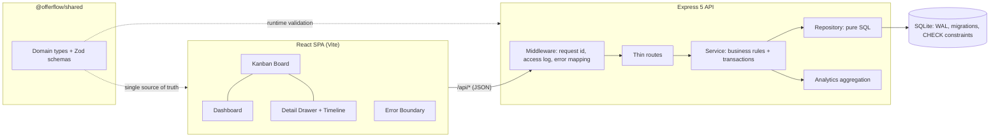

# OfferFlow

**A full-stack job application tracker** — kanban pipeline, activity timeline, and analytics dashboard. Built to turn a chaotic job search into a measurable process.


## Why

Job hunting produces dozens of applications across different stages, sources, and deadlines. Spreadsheets don't show you _where the process leaks_. OfferFlow does: drag cards through the pipeline, log every interaction, and watch response/offer rates update in real time.

## Features

- **Kanban board** — six-stage pipeline (Wishlist → Applied → Screening → Interview → Offer / Rejected) with native drag-and-drop and optimistic UI updates
- **Analytics dashboard** — response rate, offer rate, median salary, weekly activity chart, pipeline funnel, and source effectiveness (which channel actually produces offers)
- **Activity timeline** — every status change is recorded automatically; log calls, emails, notes, and tasks per application
- **Follow-up reminders** — a date per application with overdue/today/upcoming badges on cards and a grouped dashboard panel; bucketing follows your local timezone, rejections auto-clear the chase, and every schedule/clear is logged in the timeline
- **Touch & keyboard friendly** — change status right in the detail drawer (HTML5 drag-and-drop doesn't exist on touch screens)
- **CSV export & import** — download everything (including the archive) as a spreadsheet-safe CSV; import is atomic with per-row error reporting and reverses the formula-injection escaping losslessly
- **Archive** — soft-delete applications into a separate view; restore in one click; archived rows leave analytics and reminders but keep their full history
- **Dark & light themes** — one-click toggle, persisted, follows the OS preference by default
- **Markdown notes** — bold/italic/code/links/lists rendered safely (React elements, never raw HTML; http(s)-only links)
- **Full CRUD** — create/edit forms with client- and server-side validation, search by company/role/location; concurrent edits are conflict-checked (`412` + "Load latest", never a silent overwrite)
- **Accounts & isolation** — email/password registration, scrypt hashing, HttpOnly session cookies, per-user data isolation (another user's ids read as `404`); shared one-click demo account for zero-friction review
- **Demo mode** — one-click reset to a realistic seeded dataset (16 applications across European tech companies), scoped to the demo account only
- **Zero-dependency charts** — SVG charts hand-built without chart libraries
- **Production-ready** — Docker multi-stage build, GitHub Actions CI (audit gate + E2E job), health checks, strict TypeScript everywhere
- **Operable** — per-IP rate limiting (`429` + `Retry-After`), Prometheus `/api/metrics`, liveness vs readiness probes with drain-aware shutdown, generated OpenAPI 3.1 contract, online SQLite backups (`npm run backup`)

## Tech stack

| Layer    | Technology                                                      |
| -------- | --------------------------------------------------------------- |
| Frontend | React 18, TypeScript (strict), Vite, hand-rolled SVG charts     |
| Backend  | Node.js 22.13+, Express 5, Zod validation                       |
| Database | SQLite via built-in `node:sqlite` (no native deps, WAL mode)    |
| Testing  | Vitest, Supertest, Testing Library — 285 tests + Playwright E2E |
| Tooling  | ESLint 9 (flat config), Prettier, npm workspaces                |
| DevOps   | GitHub Actions CI, multi-stage Dockerfile, non-root container   |

## Architecture



- **Monorepo** with npm workspaces: `shared/`, `client/`, `server/`
- **Shared contract**: domain types and Zod schemas live in `@offerflow/shared` — contract drift becomes a compile error, not a runtime bug
- **Layered server**: routes → service → repository; business rules are testable without HTTP, SQL without rules
- **Atomic writes**: application + events commit in one transaction (re-entrant via SAVEPOINTs)
- **Forward-only migrations** with baselining for pre-existing databases
- **Observability**: structured JSON logs, per-request ids echoed to the client, coded error bodies
- **Graceful shutdown**: SIGTERM drains in-flight requests before closing the DB
- In production the Express server serves the built SPA — **one container, one port**

Design rationale is documented as ADRs in [`docs/adr/`](docs/adr/).

## Quick start

```bash
# requires Node.js >= 22.13 (first release with unflagged node:sqlite;
# enforced via engines + engine-strict, and CI tests the exact floor)
npm install
npm run dev        # API on :3000, Vite dev server on :5173 (proxies /api)
```

Open http://localhost:5173 — the database is created and seeded with demo data automatically.

### Production build

```bash
npm run build      # builds client, then server
npm start          # serves API + built SPA on :3000
```

### Docker

```bash
docker build -t offerflow .
docker run -p 3000:3000 -v offerflow-data:/data offerflow
```

## Scripts

| Command             | Description                                      |
| ------------------- | ------------------------------------------------ |
| `npm run dev`       | Run API + client in watch mode                   |
| `npm test`          | Run all test suites (server + client)            |
| `npm run lint`      | ESLint across the monorepo                       |
| `npm run typecheck` | Strict TypeScript checks                         |
| `npm run build`     | Production build (client + server)               |
| `npm start`         | Serve production build                           |
| `npm run backup`    | Online SQLite snapshot (`VACUUM INTO`, verified) |
| `npm run test:e2e`  | Playwright E2E against the production build      |
| `npm run format`    | Prettier                                         |

## API reference

| Method   | Endpoint                       | Description                                                                              |
| -------- | ------------------------------ | ---------------------------------------------------------------------------------------- |
| `POST`   | `/api/auth/register`           | Create an account; sets an HttpOnly session cookie                                       |
| `POST`   | `/api/auth/login`              | Sign in (uniform `401` for unknown email / wrong password)                               |
| `POST`   | `/api/auth/demo`               | Sign into the shared public demo account — no credentials                                |
| `POST`   | `/api/auth/logout`             | Revoke the session (idempotent)                                                          |
| `GET`    | `/api/auth/me`                 | Current user (`401` when signed out)                                                     |
| `GET`    | `/api/health`                  | Liveness probe + application count                                                       |
| `GET`    | `/api/ready`                   | Readiness probe — `503` while draining or if the DB is unavailable                       |
| `GET`    | `/api/metrics`                 | Prometheus metrics (route-pattern labels, request histogram)                             |
| `GET`    | `/api/openapi.json`            | OpenAPI 3.1 contract, generated from the live zod schemas                                |
| `GET`    | `/api/applications`            | List; `?status=`, `?q=`, `?archived=true`, `?limit=`, `?offset=`; `X-Total-Count` header |
| `POST`   | `/api/applications`            | Create (Zod-validated)                                                                   |
| `GET`    | `/api/applications/:id`        | Details with full event timeline                                                         |
| `PATCH`  | `/api/applications/:id`        | Partial update; auto-logs status changes; optional `If-Match` → `412` on stale version   |
| `DELETE` | `/api/applications/:id`        | Delete (cascades events)                                                                 |
| `POST`   | `/api/applications/:id/events` | Log a note / call / email / task                                                         |
| `GET`    | `/api/analytics/overview`      | Aggregated metrics for the dashboard                                                     |
| `GET`    | `/api/reminders`               | Applications with a follow-up date, soonest first                                        |
| `POST`   | `/api/demo/reset`              | Restore the demo dataset (demo account only)                                             |

All data endpoints require the session cookie (`offerflow_session`, or `__Host-offerflow_session` on HTTPS) and are scoped to the signed-in user; without a session they return `401 UNAUTHORIZED`. Validation errors return `400` with a structured `details` array (`{ path, message }`) that the UI maps onto form fields. Mutations are rate-limited per IP (default 120/min, `RATE_LIMIT_MAX=0` disables) and reads have a separate generous budget (default 600/min, `READ_RATE_LIMIT_MAX=0` disables; health/ready/metrics/openapi probes are exempt): exceeding a budget returns `429` with `Retry-After` and a `RATE_LIMITED` error code. Oversized bodies return `413 PAYLOAD_TOO_LARGE`; exceeding the per-account application quota returns `422 QUOTA_EXCEEDED`.

## Security posture

Hardened against failure modes reported in comparable open-source projects (full source links in [ADR-0005](docs/adr/0005-hardening-from-field-reports.md)):

- **Sessions**: opaque 32-byte cookie token, `HttpOnly` + `SameSite=Lax`; on HTTPS the cookie uses the `__Host-` prefix + `Secure` (locks it to the origin, defeats subdomain cookie tossing — the secure reader ignores plain-name cookies). Only the token's SHA-256 is stored, 7-day absolute expiry, instant revocation on logout, and at most 50 concurrent sessions per user (oldest evicted). Passwords use scrypt (N=2^17, OWASP baseline) with per-user salts, constant-time comparison, and a fail-closed verifier that rejects malformed or over-budget hash parameters instead of throwing; unknown-email logins burn a dummy hash so account enumeration has no timing oracle. Credential endpoints have their own tighter rate budget (`CREDENTIAL_RATE_LIMIT_MAX`, default 20/min).
- **Isolation**: every query is ownership-scoped by construction (`service.forUser`); cross-user ids answer `404`, never `403`, so existence is not leaked. Demo reset only touches the shared demo account.
- **CSRF**: state-changing requests with a body must be `application/json` (`415` otherwise — defeats "simple request" form posts); browser mutations need a same-origin `Origin`, an origin in `TRUSTED_ORIGINS`, or a loopback origin in development. Header-less clients (curl) are unaffected.
- **DNS rebinding**: optional `TRUSTED_HOSTS` Host-header allowlist on the API; the Vite dev server uses an explicit `VITE_ALLOWED_HOSTS` list — never `allowedHosts: true`.
- **SQLite contention**: `busy_timeout=5000` set before WAL, `BEGIN IMMEDIATE` write transactions, `synchronous=NORMAL`.
- **Headers**: Content-Security-Policy (`script-src 'self'` — inline-script injection is blocked even if an XSS vector slips past React; `frame-ancestors` is opt-in via `CSP_FRAME_ANCESTORS` so the hosted iframe preview keeps working), `X-Content-Type-Options: nosniff`, `Referrer-Policy: no-referrer`, `Permissions-Policy` denying camera/microphone/geolocation/payment, HSTS on TLS requests only, `x-powered-by` disabled.
- **Resource ceilings**: 5000 applications per account (archive included; CSV import is quota-checked atomically → `422`), 200 events per application (oldest pruned on insert — the timeline is a bounded recent-history window), 50 sessions per user, 256 KiB JSON bodies (`413`, never a logged 500), 1000-row imports with error details capped at 50.
- **Abuse brake**: fixed-window per-IP rate limits enforced before body parsing — tight for mutations, generous for reads, probes exempt; the bucket map is hard-capped (FIFO eviction) so a fresh-IP spray cannot exhaust memory; spoofed `X-Forwarded-For` is ignored unless `TRUST_PROXY_HOPS` says otherwise.
- **Connection hygiene**: explicit slowloris timeouts (`HTTP_HEADERS_TIMEOUT_MS=10s`, `HTTP_REQUEST_TIMEOUT_MS=30s`, cross-validated at startup); graceful shutdown drops idle keep-alive connections immediately and severs stuck sockets on the forced-exit path.
- **Supply chain**: CI gates on `npm audit --omit=dev --audit-level=high`; GitHub Actions pinned to immutable commit SHAs with least-privilege `permissions: contents: read` and `persist-credentials: false`; dependabot covers npm, GitHub Actions and the Docker base image. zod upgraded to 4.x to clear GHSA-mrhx-c7xc-m3w5 (memory exhaustion on oversized collections).
- Configuration knobs are documented in [`server/.env.example`](server/.env.example) and [`client/.env.example`](client/.env.example).

## Testing

```bash
npm test
```

- **API tests** (Supertest): CRUD, filtering, pagination (`X-Total-Count`, page tiling), literal `%`/`_`/`\` search, validation edge cases, coded errors (`VALIDATION_FAILED`, `NOT_FOUND`, `INVALID_JSON`), request-id propagation and sanitization, analytics correctness, empty-DB safety
- **Security tests**: cross-site CSRF rejected (including bodyless `demo/reset`), same-origin and trusted-origin flows, `415` for non-JSON mutations, Host allowlist vs DNS rebinding, SPA-fallback route-syntax regression
- **Service tests**: business rules with an injected clock — deterministic timestamps, `appliedAt` stamping rules, atomic rollback of a failing demo reset, SAVEPOINT semantics
- **Concurrency tests**: `ETag`/`If-Match` matrix (stale write → `412` without clobbering or phantom events, malformed preconditions → `400`, version backfill migration); client conflict flow (banner → rebase → resubmit with the fresh version)
- **Migration & contention tests**: idempotency, baselining a legacy database, persistence across reopen, CHECK constraints; `busy_timeout` actually waits under a held lock, `BEGIN IMMEDIATE` holds the write lock from the start, and the WAL deferred-upgrade hazard is reproduced as a documented anti-test
- **Config/logger tests**: fail-fast env validation, allowlist parsing, log levels, structured bindings
- **Client tests**: salary/date formatting, relative time, avatar colors; optimistic-overlay merge rules; hook-level race regressions (stale refetch discarded, superseded move failure doesn't roll back newer state, in-flight refetch doesn't clobber a pending move); API-client paging; drawer load-race and no-refetch-on-rerender guarantees — two overlapping calls resolved out of order, not happy-path-only
- **CSV & archive tests**: RFC 4180 quoting, formula-injection escaping + lossless round-trip, BOM/CRLF/embedded newlines, unterminated-quote rejection, per-row validation with row numbers, unknown-column and 1000-row caps, atomic import (one bad row writes nothing), export→import into a fresh account incl. archived rows; archive idempotency (no event/version churn), board/archive disjoint views, analytics/reminder exclusion, cross-user 404s
- **Markdown & theme tests**: XSS-by-construction checks (script/img inert, javascript:/data: links defused), code-span literals, lists/paragraphs; theme persistence, OS-preference fallback, stored-choice priority
- **Reminder tests**: schedule/reschedule/clear event semantics (same-date no-op), auto-clear on rejection with an explicit-patch override, soonest-first ordering, per-user isolation, date-format validation, partial-index migration; client bucketing pinned against a fixed local date (late-evening timezone edge, month boundaries) and dashboard panel grouping/degradation
- **Auth & isolation tests**: scrypt hash format + verification, cookie flags (`HttpOnly`, `SameSite=Lax`, `Secure` on HTTPS), duplicate email `409`, uniform `401` (unknown email vs wrong password), token-hash-at-rest, expiry + opportunistic sweep, credential rate budget, session replay after logout; two-user isolation at HTTP/service/SQL levels — list/get/patch/delete/events/search/analytics never cross the boundary, foreign ids answer `404` not `403`, demo reset touches only the demo account
- **Adversarial fuzz tests**: a seeded, deterministic fuzzer drives 332 hostile requests per run through the real stack — random/malformed JSON, weaponized CSV, absurd query strings, traversal/SQL path ids, invalid registrations — and asserts the invariant that no input ever yields a `5xx` and every `4xx` is a structured error; the CSV codec must throw only `ValidationError`. A future unmapped throw fails CI on the push that introduces it, with the seed and iteration to reproduce.
- **Hardening tests**: oversized body → `413` with no error log, unsupported encoding → `415`, verifier throw-paths fail closed, session eviction at the cap, event pruning at rest, quota enforcement on create and atomic import rejection, import error-detail cap, LF formula guard, CSP/HSTS/Permissions-Policy presence and conditionality, `__Host-` cookie issuance/tossing resistance/dual-name logout clear
- **Operations tests**: rate-limit matrix (mutation and read budgets, window reset, per-IP buckets behind a trusted proxy, spoofed-header resistance, 429-before-parse, probe exemption); readiness draining/unavailable; Prometheus cardinality guarantees (route patterns, no ids, single unmatched series); OpenAPI drift (router walk + live-response key comparison); backup script subprocess tests (WAL snapshot consistency, live-write point-in-time cut, overwrite refusal, integrity verification)
- **E2E tests** (Playwright, separate CI job): sixteen golden paths against the production build served by Express — auth flows (anonymous → sign-in screen, demo entry, register → private board → reload persistence, sign-out/sign-in round-trip, two-account isolation, inline wrong-password error) plus tracker paths (create → drawer move → search → dashboard, edit persistence, server-side validation round-trip, delete + reset dialogs, the follow-up lifecycle (schedule → badge → dashboard panel → rejection clears it), archive → restore, CSV export → fresh-account import, theme persistence across reload, and markdown rendering in the drawer
- CI runs audit → lint → typecheck → tests → build on every push and PR, on **both** Node 22.13.0 (the declared floor) and the latest 22.x, plus the E2E job

## Project structure

```
├── shared/                 # @offerflow/shared — the contract
│   └── src/
│       ├── types.ts        # domain types + enums (browser-safe, zero deps)
│       └── schemas.ts      # Zod schemas (separate entry point)
├── client/                 # React SPA
│   └── src/
│       ├── components/     # AuthScreen, Tracker, Board, Card, Dashboard, Form, Drawer, charts/
│       ├── hooks/          # useApplications — race-guarded list state (+ tests)
│       ├── lib/            # pure helpers (+ unit tests)
│       ├── api.ts          # typed fetch client (codes + request ids)
│       └── types.ts        # re-exports shared contract + UI metadata
├── server/                 # Express API
│   ├── src/
│   │   ├── app.ts          # composition root (dependency injection)
│   │   ├── http/           # routes + middleware (auth, security, rate limit, OpenAPI, concurrency)
│   │   ├── observability/  # Prometheus registry, readiness/lifecycle
│   │   ├── auth.ts         # scrypt hashing, hashed session tokens, demo account
│   │   ├── service.ts      # business rules, per-user scoped facade, injected clock
│   │   ├── repository.ts   # pure SQL data access (ownership-scoped)
│   │   ├── db.ts           # migrations, baselining, transaction helper
│   │   ├── analytics.ts    # metric aggregation
│   │   ├── config.ts       # fail-fast env validation
│   │   ├── logger.ts       # structured JSON logger
│   │   ├── errors.ts       # typed domain errors
│   │   └── seed.ts         # demo dataset
│   ├── scripts/            # backup.mjs — verified online snapshots
│   └── tests/              # API, auth, isolation, security, concurrency, ops, contract suites
├── tests/e2e/              # Playwright golden paths (production build, CI job)
├── docs/adr/               # architecture decision records
├── .github/                # CI workflows + dependabot
└── Dockerfile              # multi-stage, non-root, healthcheck
```

## Design decisions

Full rationale lives in [`docs/adr/`](docs/adr/); the short version:

- **Shared contract package** ([ADR-0001](docs/adr/0001-shared-contract-package.md)) — types and Zod schemas in one workspace package; contract drift fails the build on both sides.
- **Layered server** ([ADR-0002](docs/adr/0002-layered-architecture.md)) — routes → service → repository, with an injected clock and a composition root for testability.
- **Migrations + transactions** ([ADR-0003](docs/adr/0003-migrations-and-transactions.md)) — forward-only schema history, baselining for legacy DBs, atomic multi-writes via re-entrant SAVEPOINTs, CHECK constraints as a safety net.
- **Observability + lifecycle** ([ADR-0004](docs/adr/0004-observability-and-lifecycle.md)) — structured logs, request ids end-to-end, fail-fast config, graceful shutdown.
- **Hardening from field reports** ([ADR-0005](docs/adr/0005-hardening-from-field-reports.md)) — every fix traced to a published issue in our exact stack: `busy_timeout` + `BEGIN IMMEDIATE` for SQLite lock errors, a real Node floor, Vite Host allowlist instead of `allowedHosts: true`, CSRF/Origin/Content-Type guards, and race-proof optimistic UI.
- **Optimistic concurrency** ([ADR-0006](docs/adr/0006-optimistic-concurrency.md)) — row versions + `ETag`/`If-Match`: form edits from a stale tab get `412` with a "Load latest" rebase flow instead of silently overwriting another tab's save; intent-style drag moves stay last-write-wins.
- **Production operations** ([ADR-0007](docs/adr/0007-production-operations.md)) — rate limiting, Prometheus metrics, readiness/drain, generated OpenAPI 3.1 with drift tests, verified `VACUUM INTO` backups, CI-only Playwright E2E; zero new runtime dependencies.
- **Authentication & multi-user** ([ADR-0008](docs/adr/0008-authentication-and-multi-user.md)) — server-side sessions (only SHA-256 of the cookie token is stored), scrypt password hashing with timing-equalized logins, ownership bound at the HTTP boundary via a scoped service facade, `404`-not-`403` cross-user semantics, a shared resettable demo account, and a separate credential rate budget.
- **Follow-up reminders** ([ADR-0009](docs/adr/0009-follow-up-reminders.md)) — one date per application with a partial index, client-side timezone-aware bucketing, system `reminder` events, and auto-clear on rejection.
- **CSV, archive, themes, markdown** ([ADR-0010](docs/adr/0010-csv-archive-theme-markdown.md)) — RFC 4180 export/import with formula-injection escaping and atomic validation, idempotent soft-archive with history, CSS-variable theming, and a safe-by-construction markdown subset — all with zero new dependencies.
- **Security audit & hardening** ([ADR-0011](docs/adr/0011-security-audit.md)) — http(s)-only posting URLs (stored-XSS fix at schema, render and CSV-import layers), OWASP-baseline scrypt (N=2^17) with fail-closed hash verification, advisory-clean dependency tree including dev, plus live-probed SQLi/CSRF/traversal/isolation defenses.
- **Second-pass hardening** ([ADR-0012](docs/adr/0012-second-pass-hardening.md)) — resource-exhaustion ceilings (sessions, events, per-account quota, read budget, error-detail cap), correct `413`/`415` body-parser mapping, CSP/HSTS/Permissions-Policy, `__Host-` cookies on HTTPS, and SHA-pinned least-privilege CI.
- **Adversarial robustness** ([ADR-0013](docs/adr/0013-adversarial-robustness.md)) — a permanent seeded fuzz suite pinning the "no hostile input → 5xx" invariant, a hard-capped rate-limiter bucket map, slowloris connection timeouts, and connection-aware graceful shutdown.
- **`node:sqlite` over an ORM** — the domain is small; plain SQL with a repository layer keeps the data flow explicit and the dependency tree tiny.
- **Native HTML5 drag-and-drop** — no dnd library needed for a single-board use case; the drawer's status select covers touch devices and keyboard users.
- **Hand-built SVG charts** — three focused visualizations don't justify a 300 KB charting dependency.
- **Optimistic updates** — moving a card updates the UI instantly; race guards (latest-only refetch, per-card mutation sequencing, pending-status overlay) keep out-of-order responses from clobbering newer state.
- **Events as a first-class table** — status history is never overwritten, which makes the timeline and analytics trustworthy.
- **Complete reads** — the list endpoint reports `X-Total-Count` and the client follows it page by page, so the board never silently truncates at the server's page default; search escapes LIKE metacharacters so `100%` finds `100%`, not everything.

## Roadmap

- [x] Authentication & multi-user support
- [x] CSV import/export
- [x] Interview reminders (follow-up dates with overdue/today/upcoming buckets)
- [x] Playwright end-to-end tests (CI job against the production build)

## License

[MIT](LICENSE)
